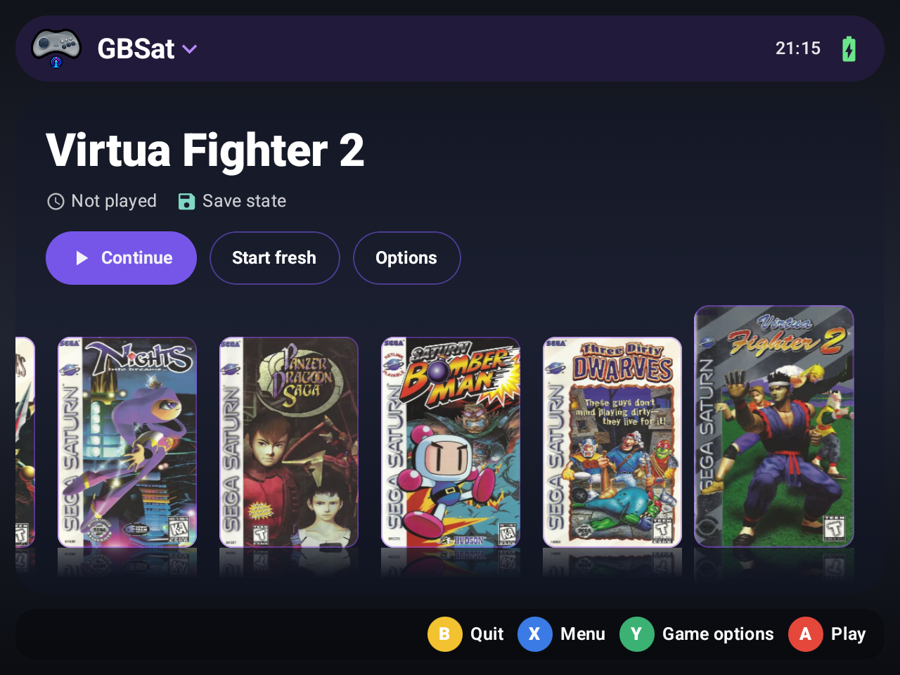
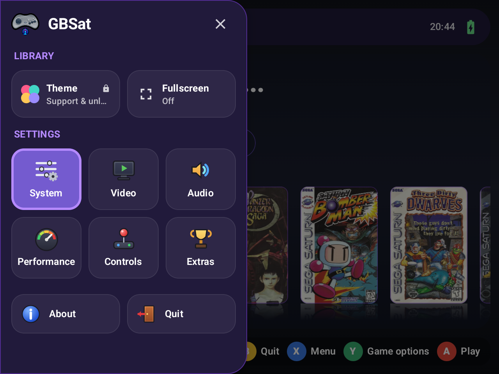
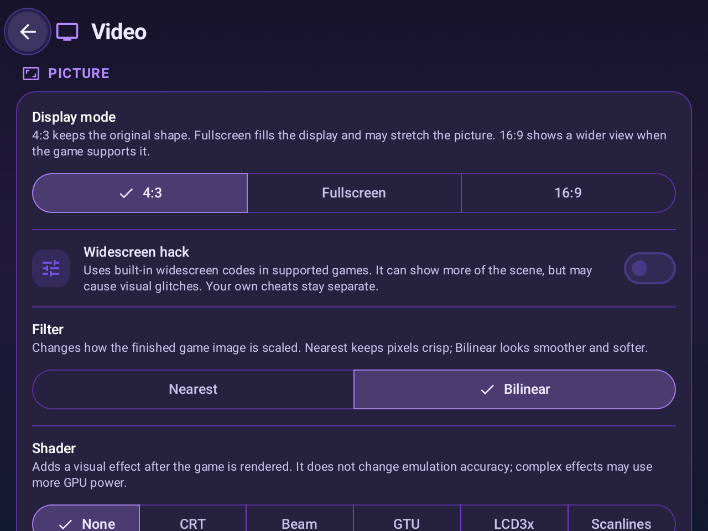
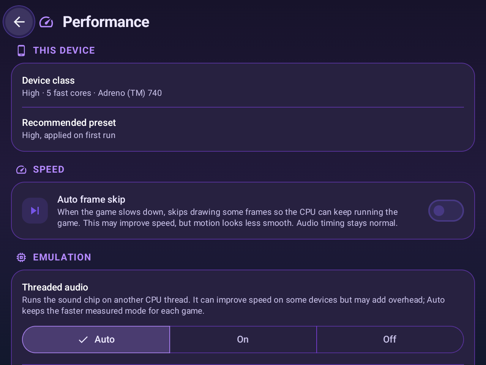
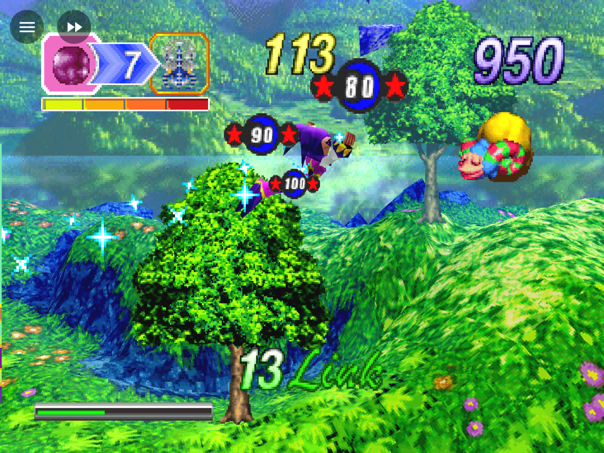

<div align="center">

# GBSat

**Sega Saturn emulation for Android phones and handhelds**

Vulkan rendering · Save states · RetroAchievements · Controller and touch input

[Download the latest APK](https://github.com/mindspotgb/GBSat/releases/latest) · [Changelog](CHANGELOG.md) · [Privacy policy](PRIVACY.md)



</div>

GBSat is a Sega Saturn emulator for Android phones and handhelds, built with the shared [GBFrame](https://github.com/mindspotgb/GBFrame) app framework. This repository contains the Android app, its emulation core, and the dependencies needed to build it.

## Highlights

| | |
| --- | --- |
| 🎮 **Saturn emulation** | GBSat runs Sega Saturn games with Vulkan rendering and an OpenGL ES compatibility renderer |
| 🕹️ **Built for handhelds** | Controller navigation and remapping, touch controls, and an in-game quick menu |
| 💾 **Save states** | Automatic and manual states, screenshots, resume support, and data-folder backup workflows |
| 🏆 **RetroAchievements and cheats** | Optional RetroAchievements support and per-game cheats |
| 🖼️ **Game library** | Game covers, play time, and Showcase, Grid, and All in One layouts |
| ⚙️ **Per-game settings** | Recommended device-aware profiles, display modes, filters, shaders, and performance options |

## Screenshots

These screenshots show the app using real Saturn games and their actual cover art.

<p align="center">
  
  
</p>
<p align="center">
  
  
</p>

## All features

- **Emulation:** Sega Saturn games with a BIOS and common disc-image formats supplied by the user.
- **Video:** Vulkan renderer with enhanced internal resolution, OpenGL ES renderer for compatibility, 4:3/16:9/full-screen display modes, supported widescreen hacks, filters, and shaders.
- **Audio and performance:** Audio controls, fast-forward, automatic frame skip, and device-aware per-game performance profiles.
- **Input:** Physical controller support and button remapping, Saturn touch controls with configurable haptics, hotkeys, and a controller-friendly in-game quick menu.
- **Saves and library:** Automatic and manual save states, resume support, game covers, play time, and Showcase, Grid, and All in One library layouts.
- **Online and customization:** Optional RetroAchievements and cheats. A one-time Gold purchase supports the developer and unlocks the Grid and All in One library themes; emulation and custom cover images remain available without Gold.

## Requirements

- Android 9 or newer on a 64-bit ARM device (`arm64-v8a`).
- A Sega Saturn BIOS and game disc images that you are legally entitled to use. They are not included or distributed by GBSat.

## Getting started

1. Install the APK from [GitHub Releases](https://github.com/mindspotgb/GBSat/releases/latest).
2. In the setup wizard or System settings, select your Saturn BIOS and games folder. The folder picker grants access to the selected files; broad storage permission is not required.
3. Choose a game from the library. Connect a physical controller or use the on-screen controls.

The library supports common Saturn disc formats including CUE/BIN, CHD, ISO, MDS, and CCD. Multi-file disc sets must keep their related track files together and accessible through the selected folder.

## Downloads and versions

Stable APKs and release notes are published on [GitHub Releases](https://github.com/mindspotgb/GBSat/releases). Development build artifacts are available from successful runs in the repository's **Actions** tab. The app is distributed for Android `arm64-v8a`; this repository does not publish desktop builds.

## Building

Clone the repository and its submodules:

```powershell
git clone --recurse-submodules https://github.com/mindspotgb/GBSat.git
```

Open `apps/android` in Android Studio, or use the included Gradle wrapper. The Android build uses the SDK, NDK, CMake, and Java versions declared by the project. Building the Vulkan shaders also requires DXC with SPIR-V support on `PATH`.

For Windows local signing and build instructions, see [apps/android/README.md](apps/android/README.md) and [`tools/build-local.ps1`](tools/build-local.ps1). Keep the release keystore and password outside the repository.

## Project layout

- `apps/android` — Android app, Kotlin/Compose UI, JNI bridge, and app assets.
- `libs/gbsat-core` — Saturn emulation core used by GBSat.
- `libs/gbframe` — shared Android UI and device framework, pinned as a Git submodule.
- `vendor` — native dependencies pinned to the revisions used by the Android build.
- `cmake`, `tools`, `.github/workflows` — native build support and Android CI/release workflows.

## Privacy

GBSat has no ads or analytics. Optional network features and the data they use are described in the [privacy policy](PRIVACY.md). The app does not include BIOS files or games.

## References

GBSat includes the [Ymir](https://github.com/StrikerX3/Ymir) emulation core. See the repository's third-party notices for source revisions and license details.

## License and trademarks

GBSat is distributed under [GNU GPL version 3](LICENSE). Third-party components retain their own licenses and notices, included with the app where required. Sega Saturn is a trademark of SEGA. GBSat is not affiliated with or endorsed by SEGA.
